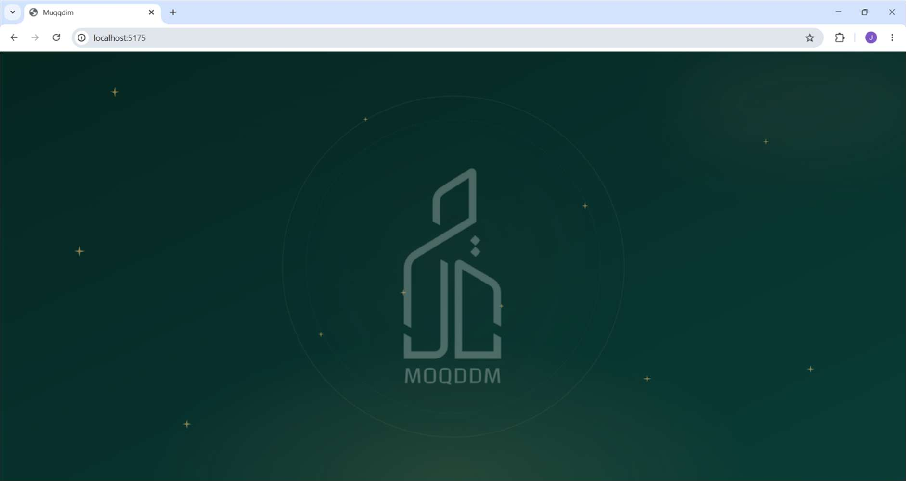
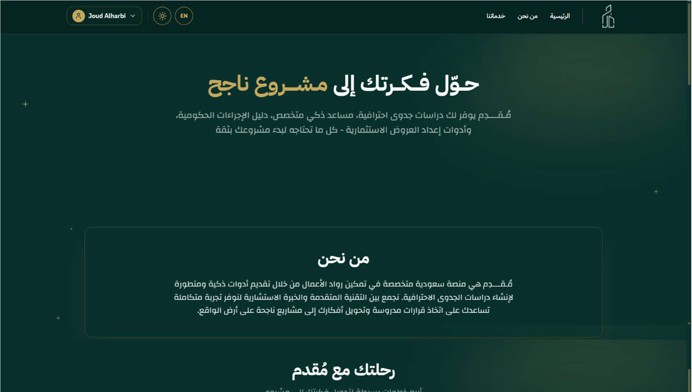
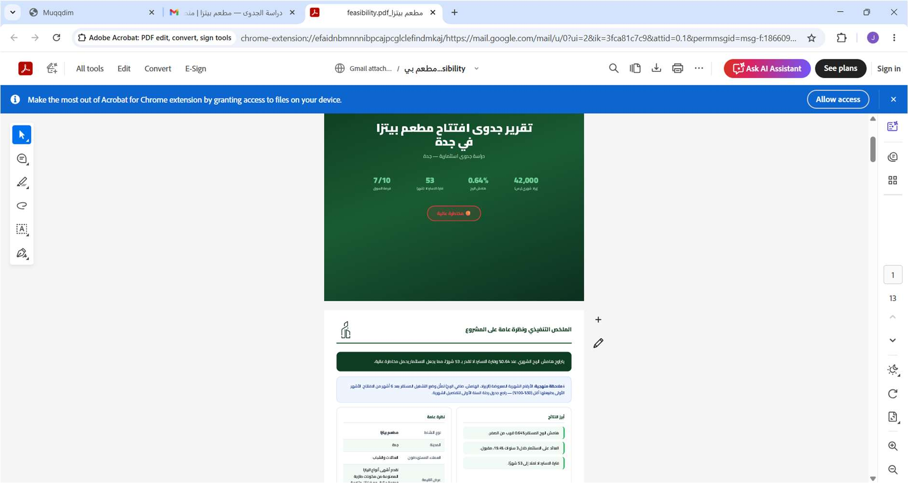
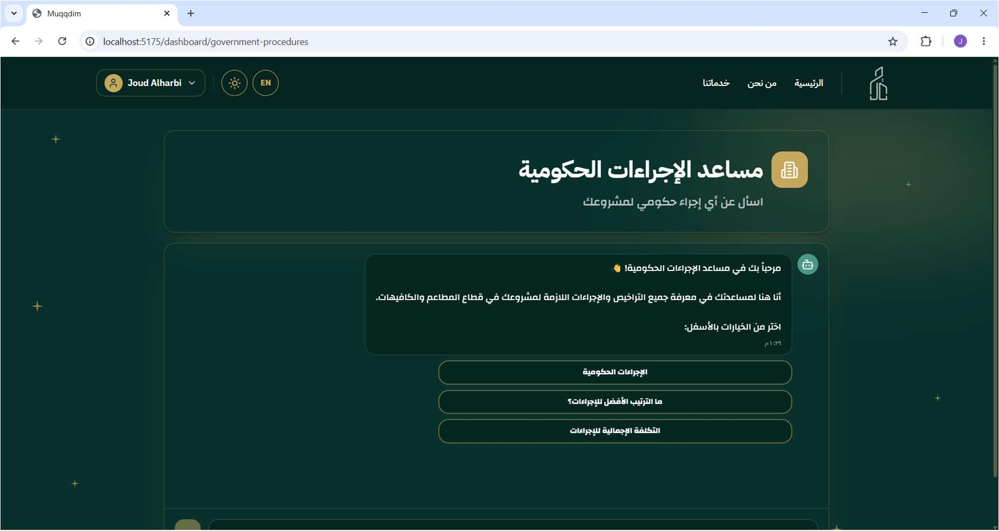
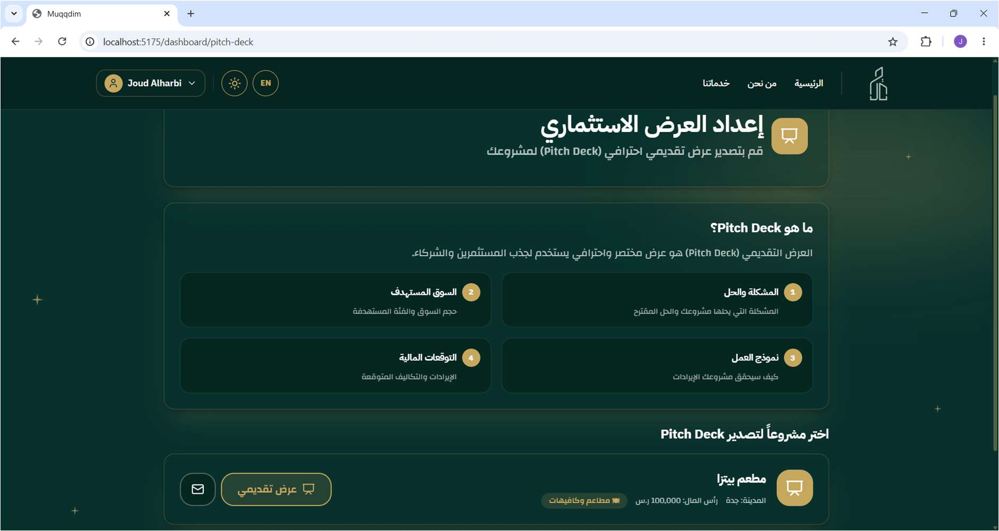
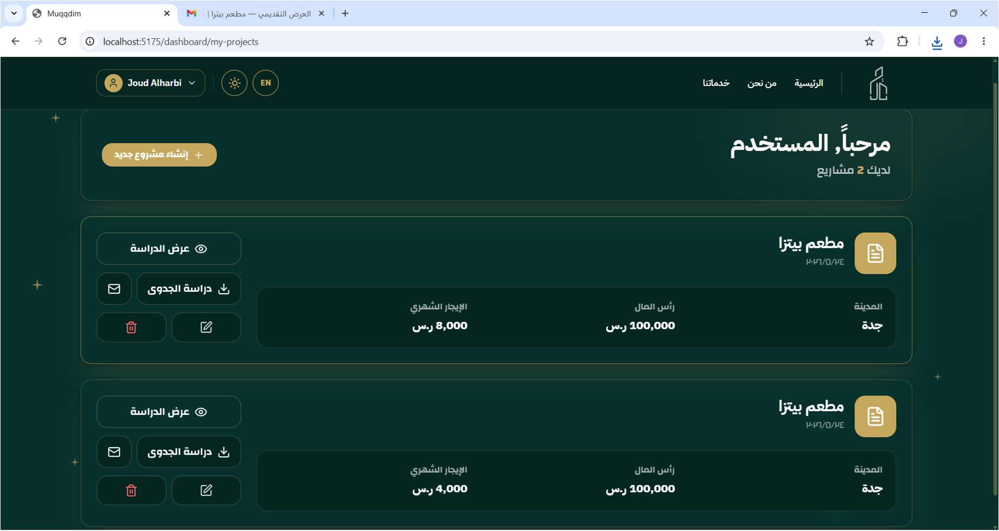

  

  

  <b>Turning Business Ideas into Informed Decisions</b>

  
  
  

---

## 🌿 About Muqddm

**Muqddm** is an AI-powered web platform developed to help aspiring entrepreneurs in Saudi Arabia evaluate business ideas, prepare feasibility studies, and make informed decisions.

It combines market and financial analysis with AI-powered guidance, downloadable reports, and investor pitch decks.

Developed as a graduation project by four Information Technology students at **King Abdulaziz University**.

---

## 🛠️ Tech Stack

### 💻 Frontend

  
  
  
  

### ⚙️ Backend & Database

  
  
  

### 🤖 AI & Integrations

  
  
  
  

### 🎨 Design

  

---

## ✨ Key Features

| Feature | Description |
|:--|:--|
| 📊 **AI Feasibility Studies** | Generates structured reports with market insights, financial projections, risks, and recommendations |
| 📍 **Competitor Analysis** | Retrieves location-based competitor information using Google Places API |
| 🤖 **AI Study Advisor** | Allows users to discuss feasibility reports and explore recommendations |
| 🏛️ **Government Procedures Assistant** | Provides guidance on Saudi business registration and licensing procedures |
| 📈 **Financial Decision Support** | Presents estimated costs, revenues, profitability, and feasibility indicators |
| 📑 **Reports & Pitch Decks** | Generates downloadable PDF reports and PowerPoint investor presentations |
| 🌐 **Bilingual Interface** | Supports Arabic and English |
| 🔐 **Project Management** | Enables user authentication and management of saved projects |

---

## ⚙️ How It Works

**1. Create an Account**  
Sign up or log in securely using Firebase Authentication.

**2. Enter Business Details**  
Provide information about the business idea, including location, budget, and estimated operating costs.

**3. Generate a Feasibility Study**  
The platform combines financial calculations, competitor information, and AI-powered analysis to generate a feasibility report.

**4. Explore the Results**  
Review financial projections, market insights, risk assessments, and feasibility recommendations.

**5. Consult the AI Assistants**  
Discuss the results with the AI Study Advisor or explore Saudi business setup procedures.

**6. Export Documents**  
Download feasibility reports in PDF format or generate investor pitch decks in PowerPoint format.

---

## 📸 Project Screenshots

### 🏠 Landing Page & Dashboard

| Landing Page | Dashboard |
|:--:|:--:|
|  |  |

### 📊 Feasibility Report & AI Assistant

| Feasibility Report | Government Procedures Assistant |
|:--:|:--:|
|  |  |

### 📑 Pitch Deck & Project Management

| Pitch Deck Generator | My Projects |
|:--:|:--:|
|  |  |

---

## 👥 Project Team

Muqddm was developed as a graduation project by a team of four Information Technology students at King Abdulaziz University.

### Team Members

- **Jinan Fahad Almidfa**
- **Aljoharah Aloraini**
- **Joud Alharbi**
- **Norah Alswayed**

**King Abdulaziz University**  
Faculty of Computing and Information Technology  
Department of Information Technology  

**Academic Year:** 2025–2026

---

  

